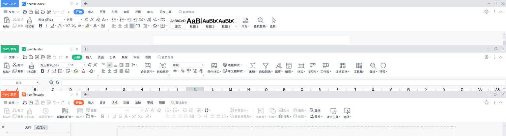

# WPS for Linux Clean International Build (RPM)

基于 WPS Office 官方 Linux 国际版 RPM 的中文精简重打包项目，面向需要本地文字、表格和演示功能，但不需要独立 PDF 程序、云端入口及更新器的用户。

保留国际版程序核心，补充简体中文资源与符号字体，提供可由系统包管理器安装、升级和卸载的 RPM。

> 本项目不是 WPS 官方发行版，也不是免安装便携版。“精简”指对包内容进行静态清理，不代表已经完成运行时网络审计，不能保证完全不联网或无遥测。

## 功能与边界

| 项目 | 处理方式 |
| --- | --- |
| 文字、表格、演示 | 保留国际版核心程序 |
| 简体中文 | 设置中文界面，并为语言包补充旧版 Qt 兼容索引，覆盖三个编辑器的主要工具栏 |
| 符号字体 | 加入 Symbol、Wingdings、Wingdings 2、Wingdings 3、Webdings、MT Extra 六种实际字体 |
| 独立 WPS PDF | 移除程序、启动命令和桌面入口 |
| 文档导出 PDF | 保留相关共享库，不随独立 PDF 程序一起删除 |
| 云端、推广、更新器 | 静态移除已知的相关进程、插件和入口 |
| 桌面集成 | 保留普通文档 MIME 关联，统一使用系统标准 Office 分类 |
| 输入法 | 包含 Wayland / XWayland 下的 Fcitx5 环境变量兼容处理 |
| 命令冲突 | 使用 `wps`、`wpset`、`wpswpp`，不占用 `et` 和 `wpp` |

### 编辑器界面

下图依次为文字、表格和演示的实际工具栏，不只是启动页的中文界面。



## 当前发行版本

- RPM：`wps-office-11.1.0.11723.XA-4.linuxwps.fc44.x86_64.rpm`
- 国际版底包：`11.1.0.11723.XA`
- 中文资源来源：`12.1.2.28080.AK.preread.sw.Personal`
- 已验证环境：Fedora 44、KDE Plasma、x86_64；Wayland 会话下通过 XWayland 运行。
- 其他 RPM 发行版尚未验证；不支持 ARM，也不提供 DEB、Flatpak 或 AppImage 发行包。

底包与中文资源版本不同。项目通过翻译兼容处理解决已验证的工具栏问题，但不承诺所有对话框、插件和未来版本都能完整汉化。

## 下载与安装

从 [GitHub Releases](https://github.com/Uspro7/WPS-for-Linux-Clean-International-Build-RPM-/releases) 下载同一版本的 RPM 和 `SHA256SUMS`，放在同一目录。

先保存文档并退出所有 WPS 窗口，然后运行：

```bash
sha256sum -c SHA256SUMS
sudo dnf install ./wps-office-11.1.0.11723.XA-4.linuxwps.fc44.x86_64.rpm
```

校验通过后再安装。若提示同名文件已由其他 WPS 软件包拥有，请先阅读 [故障排查](docs/TROUBLESHOOTING.md)，不要使用 `--force` 覆盖。

本包使用 `wps-office` 包名，并安装到 `/opt/kingsoft/wps-office`，不适合与另一个使用同一路径的 WPS 包并存。RPM 未签名；SHA-256 用于检查下载完整性，不等同于发布者签名。

### 启动

可以从系统“办公”菜单启动，也可以使用：

```bash
wps        # WPS 文字
wpset      # WPS 表格
wpswpp     # WPS 演示
```

启动器会将当前用户 WPS 配置中的界面语言设为 `zh_CN`，不修改系统全局语言。首次修改已有配置时会保存 `Office.conf.linuxwps-backup`。

### 卸载

```bash
sudo dnf remove wps-office
```

卸载不主动清除用户目录中的设置和文档。

## 自行构建

在 Fedora x86_64 环境中：

```bash
sudo dnf install git rpm-build rpm cpio wget curl unzip python3 fontconfig

git clone https://github.com/Uspro7/WPS-for-Linux-Clean-International-Build-RPM-.git
cd WPS-for-Linux-Clean-International-Build-RPM-
./build-rpm.sh
```

构建本身不需要 root。首次构建会下载官方 RPM 和字体归档，产物位于 `build/dist/`。请预留数 GB 磁盘空间；具体来源、缓存规则和验证方法见 [构建文档](docs/BUILD.md)。

项目不重新编译 WPS 的闭源代码，也不修改其程序二进制。构建输入版本、系统 RPM 宏和缓存会影响产物，当前不保证字节级可复现构建。

## 文档

- [构建与测试](docs/BUILD.md)
- [项目结构与定制原理](docs/ARCHITECTURE.md)
- [安装及故障排查](docs/TROUBLESHOOTING.md)
- [发行流程](docs/RELEASING.md)
- [更新记录](CHANGELOG.md)
- [本次发行说明](docs/releases/v11.1.0.11723.XA-4.md)

`build-rpm.sh` 是本项目的 RPM 构建入口。保留的 `repack.sh` 和 `.source.lock` 属于上游历史 DEB 构建流程，不用于本发行版；旧工作流已归档为示例，不会自动运行。

## 来源与权利说明

- 官方国际版：[WPS Office for Linux](https://www.wps.com/office/linux/)
- 官方中文资源：[WPS Linux](https://linux.wps.cn)
- 上游重打包项目：[Rongronggg9/wps-office-repack](https://github.com/Rongronggg9/wps-office-repack)
- 符号字体来源：[Rongronggg9/wps-fonts](https://github.com/Rongronggg9/wps-fonts)

本项目保留上游提交历史，并在其基础上提供原生 RPM 构建、中文兼容和精简处理。WPS 程序、语言资源及专有字体的权利和许可不因本仓库公开而改变，请遵循各自权利人的使用及分发条款。本仓库不将这些资源声明为开源软件。
